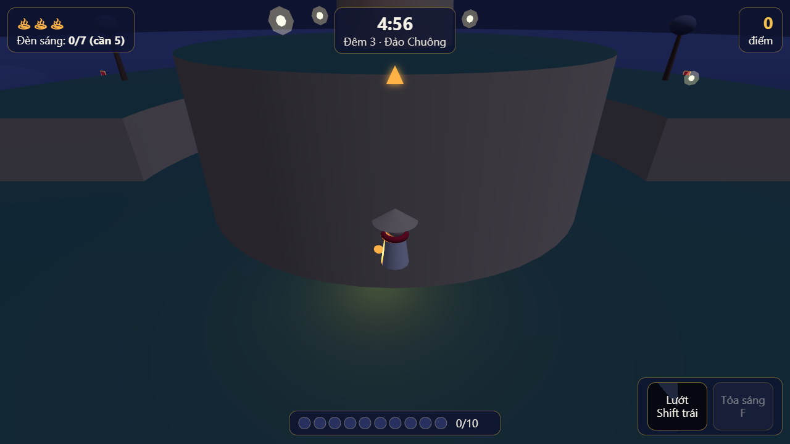
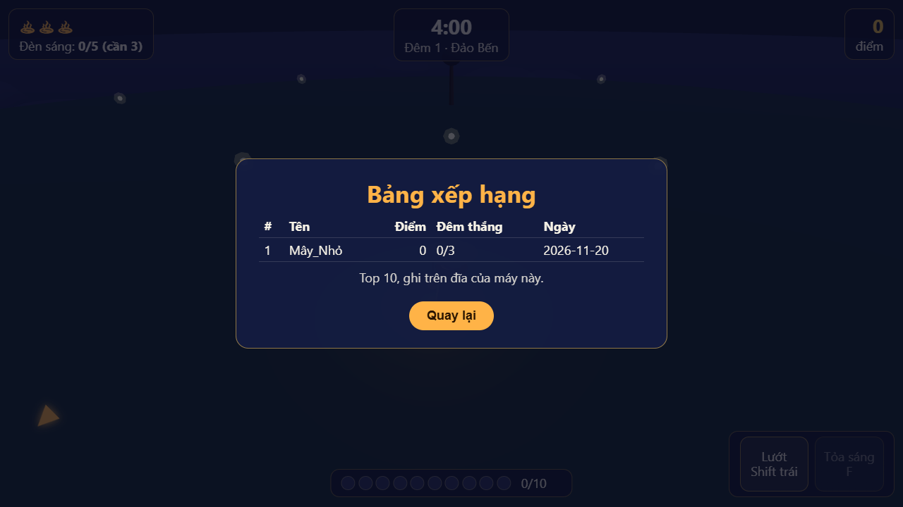
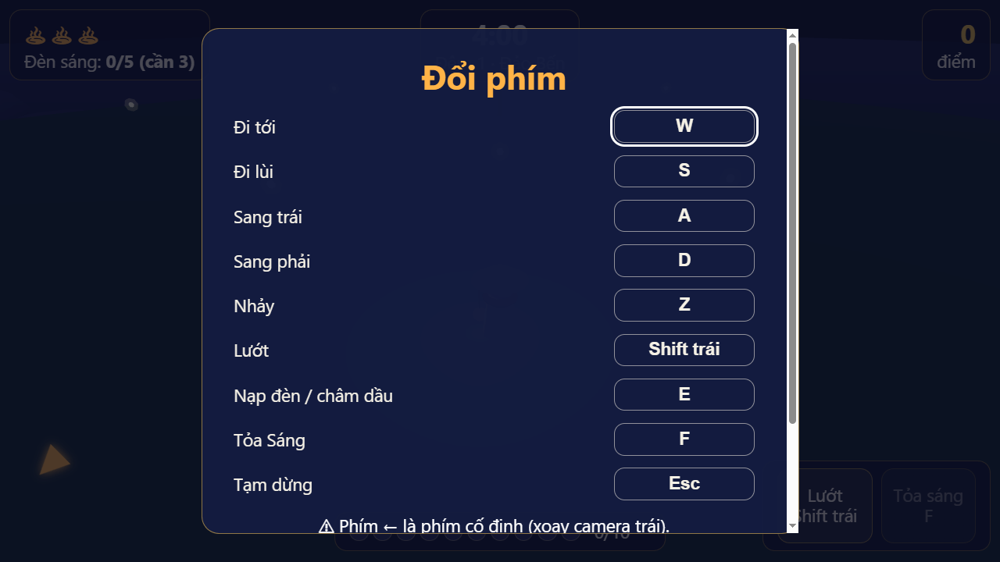

# Đảo Đèn Lồng v1.0.0

Game 3D góc nhìn thứ ba chạy trên trình duyệt. **Mây**, người giữ đèn nhỏ tuổi, gom đom đóm, thắp các **Đèn Lồng Lớn** trên ba hòn đảo (Đảo Bến, Đảo Cau, Đảo Chuông) và **giữ cho đảo sáng tới bình minh**, trong khi **Bóng Mực** hút dầu đèn và **Gió Lạc** cướp đom đóm.
Bài lab AI-SDLC Day 12, cá nhân (MSSV 2A202603608). Đề lab gốc: [docs/LAB-README.md](docs/LAB-README.md).

- Video demo: **chưa có** (xem [Giới hạn đã biết](#giới-hạn-đã-biết)).
- Bản chơi trực tuyến (Claude Artifact, riêng tư): https://claude.ai/artifact/LcX17RrMrfnZyxtPATJchU
- Phát hành: [docs/RELEASE-v1.0.0.md](docs/RELEASE-v1.0.0.md) (thư mục web tĩnh và Docker).

| Đêm 3 · Đảo Chuông | Bảng xếp hạng | Đổi phím |
|---|---|---|
|  |  |  |

## Yêu cầu hệ thống

- Node.js 18 trở lên (đã chạy với 22), macOS, Linux hoặc Windows.
- Trình duyệt hiện đại có WebGL (Chrome, Edge, Firefox). Cần GPU để đạt 60 FPS; thử trên máy có card tích hợp AMD Ryzen 5 5500U cho 188 FPS ở benchmark.
- Benchmark cần thêm Chrome hoặc Edge (đặt biến `CHROME=...` nếu cài ở chỗ khác).

## Cài đặt và chạy

```bash
npm install        # cài three.js
npm start          # mở http://localhost:8080
npm test           # 68 test, tất cả phải đạt
```

Cổng khác: `PORT=3000 npm start`. Thêm `?seed=123` vào URL để cố định seed, `?night=2` để vào thẳng Đêm 2.

## Điều khiển

Phím mặc định; **mọi phím đều đổi được** trong Cài đặt → Đổi phím (có cảnh báo khi trùng phím và nút "Khôi phục mặc định").

| Phím | Hành động |
|---|---|
| W A S D | Đi, theo hướng camera |
| Space | Nhảy (chỉ khi đang chạm đất) |
| Shift trái | Lướt (14 m/s trong 0,2 s, hồi chiêu 1,5 s) |
| E | Nạp ánh sáng vào đèn tối, hoặc châm dầu cho đèn đang sáng, trong tầm 2 m |
| F | Tỏa Sáng: xua Bóng Mực (tốn 3 đom đóm) |
| Esc | Tạm dừng |
| ← / → hoặc kéo chuột | Xoay camera (cố định). R: chơi lại Đêm. Enter: xác nhận |

## Luật chơi và cách tính điểm

Số liệu chuẩn nằm ở [src/tuning.js](src/tuning.js), khớp [game.contract.json](game.contract.json).

- **Mục tiêu**: còn sống lúc bình minh và có ít nhất **60% số đèn còn sáng** (3/5, 4/6, 5/7). Đêm dài 240 / 270 / 300 s, **không còn thắng sớm**.
- **Nhiên liệu**: đèn mới thắp có 100 dầu, hao 1 dầu mỗi giây, hết dầu thì tắt. Bấm E ở đèn đang sáng để **châm dầu** (mỗi đom đóm cho 10 dầu). Đèn dưới 30 dầu nhấp nháy và **mất vùng an toàn**.
- **Thắp**: đèn chưa từng sáng cần **10** đom đóm, đèn đã từng sáng chỉ cần **5**. **Sức chứa** bắt đầu 10, tăng 2 sau mỗi lần thắp thành công, tối đa 20.
- **Bóng Mực** đuổi Mây trong 12 m; khi rảnh thì đi tới đèn yếu nhất, **hút 5 dầu mỗi giây** (cộng dồn). Chạm Mây là mất 1 Ngọn Lửa (có 3), đánh rơi một nửa đom đóm đang mang. **Tỏa Sáng** (3 đom đóm, 5 m, hồi chiêu 3 s) làm chúng choáng 2 s và đẩy lùi 4 m.
- **Vùng an toàn** 6 m quanh đèn có từ 30 dầu: Bóng Mực không vào được.
- Đêm 2 và 3 có **bục nhảy**, **Gió Lạc**, **Bùa Gió**; Đêm 3 có **gió mạnh**. Chi tiết: [docs/SPEC-PHASE2.md](docs/SPEC-PHASE2.md).
- **Điểm**: +5 mỗi đom đóm nạp hoặc châm dầu; +100 thắp lần đầu; +40 thắp lại; +5 mỗi Bóng Mực trúng Tỏa Sáng (+15 nếu nó đang hút dầu). Khi thắng ở bình minh: mỗi đèn còn sáng +50 cộng phần nguyên dầu còn lại, mỗi Ngọn Lửa còn lại +50. Tổng điểm là tổng điểm các Đêm đã thắng.
- **Thua**: hết Ngọn Lửa, hoặc hết giờ mà đèn sáng dưới ngưỡng. Thua thì chơi lại Đêm đó.

## Bảng xếp hạng

Sau màn Bình Minh hoặc khi thua ở bất kỳ Đêm nào, nhập tên (3–12 ký tự: chữ, số, `_`; có dấu tiếng Việt được) để lưu điểm. Top 10, điểm giảm dần, bằng điểm thì ai đạt trước đứng trên. Mỗi mục có `name`, `score`, `nights_won`, `achieved_at` (ISO 8601 có múi giờ), `seed`. Xem ở menu chính → Bảng xếp hạng.

Dữ liệu ghi ra đĩa tại `data/leaderboard.json` (hoặc thư mục `DDL_DATA_DIR`) nên còn sau khi tắt và mở lại. Xuất ra file:

```bash
node server.js --export-leaderboard out.json      # {"entries": [...]} đúng thứ tự
```

Bản web tĩnh và bản Artifact không có máy chủ nên lưu bảng xếp hạng trong trình duyệt (không xuất được bằng lệnh).

## Dễ tiếp cận

- **Đổi phím** cho di chuyển 4 hướng, nhảy, lướt, tương tác, tỏa sáng, tạm dừng; phát hiện trùng; khôi phục mặc định; được lưu.
- **Chỉ báo hình ảnh** cho âm thanh: Bóng Mực xuất hiện (chú thích hướng và mũi tên ở mép màn hình), gió sắp thổi, 10 giây cuối (số lớn), đèn dưới 30 dầu.
- **Giảm chuyển động**: tắt rung camera, chớp màn hình, nhấp nháy.
- **Cỡ chữ**: tối thiểu 18 px ở 1280×720, tùy chọn chữ lớn ×1,25.
- **Bảng màu dễ phân biệt**: Bóng Mực xanh lam #00B3FF, cảnh báo màu trắng kèm ⚠; đèn tắt luôn xẹp 20% và có vết rách nên không dựa vào màu.

## Chế độ headless (Test Contract v1.3)

```bash
node src/headless.js --seed 42 --night 1 [--scenario s.json] [--inputs i.json] --ticks 600 --out out/run.jsonl [--snapshot-every 10]
```

`--night` nhận 1, 2, 3. Mã thoát: 0 thành công, 2 file inputs/scenario sai định dạng, 1 lỗi khác. Một Đêm đầy đủ chạy khoảng 0,4 giây. Lõi mô phỏng [src/sim.js](src/sim.js) dùng chung cho headless, web, benchmark và test. Các điểm cần biết khi chấm (chỗ đề chưa nêu rõ và cách tôi chọn) nằm trong mục Giả định của [SPEC-PHASE2](docs/SPEC-PHASE2.md), [SPEC-PHASE3](docs/SPEC-PHASE3.md) và [SPEC-PHASE4](docs/SPEC-PHASE4.md). Một số điểm chính:
- `player.invuln` trong snapshot tính bằng giây còn lại. Fuel của đèn là số thực 1 chữ số thập phân (bên trong là số nguyên 1/60).
- Sự kiện `night_start` phát ở tick 1. Điểm xuất phát Đêm 3 là (0, 0, −15). Góc bản đồ đo theo (cos, sin) trên XZ.
- `score` có cả trong `tuning` và ở cấp ngoài contract; `per_second_left` là 0.

## Benchmark

```bash
npm run bench      # node scripts/bench.mjs --seed 42 --duration 30 --out bench.json
```

Mở Chrome (headless, dùng GPU, cửa sổ 1280×720) vào cảnh chuẩn: Đêm 1, 200 Bóng Mực `wander`, 100 đom đóm, L1–L3 sáng, camera bay vòng bán kính 30 m cao 15 m, 15 s một vòng; 3 s khởi động rồi đo `--duration` giây. **Tắt vsync bằng cờ Chrome** (`--disable-gpu-vsync --disable-frame-rate-limit`); trình duyệt không bảo đảm tắt hoàn toàn, nên `vsync_off: true` chỉ nghĩa là đã dùng các cờ này. Số đo của tôi nằm ở [bench.json](bench.json) (avg 192 FPS, p1 low 49 FPS, load 0,8 s trên AMD Ryzen 5 5500U, card tích hợp, 7 GB RAM). `peak_mem_mb` là tổng bộ nhớ các tiến trình Chrome, lấy mẫu ngoài khoảng đo, thường lớn hơn bộ nhớ thật. `HEADED=1` mở cửa sổ thật.

## Soak test

```bash
npm run soak       # node --expose-gc scripts/soak.js --seed 7 --nights 10 --out soak.json
```

Chạy 10 Đêm liên tiếp trong một tiến trình (Đêm 1→2→3 xoay vòng, Đêm i dùng seed 7 + i, đầu vào ngẫu nhiên theo seed). Kết quả của tôi: [soak.json](soak.json) (0 crash, 37,4 → 40,8 MB). Ghi chú: tiến trình được khởi động nóng bằng một ván nháp trước khi đọc `mem_start_mb`, và RSS được đọc sau khi thu gom rác; nếu không, RSS lúc khởi động (30 MB) thấp hơn lúc ổn định (40 MB) dù heap không tăng. Đầu vào ngẫu nhiên không giữ nổi 60% đèn tới sáng nên kết quả toàn `lost`: soak kiểm tra độ ổn định, không phải độ khó.

## Kiểm chứng và tài liệu

- [docs/evidence/phase4/EVIDENCE.md](docs/evidence/phase4/EVIDENCE.md): 28 kịch bản headless (chạy hai lần, so từng byte), hiệu năng, benchmark, soak, Chrome thật. Sinh lại bằng `npm run evidence`. Ảnh chụp: [docs/evidence/screens/](docs/evidence/screens/). Bằng chứng các phase trước: [phase1](docs/evidence/phase1/), [phase2](docs/evidence/phase2/), [phase3](docs/evidence/phase3/).
- Đặc tả và tiêu chí nghiệm thu: [SPEC-PHASE2](docs/SPEC-PHASE2.md), [SPEC-PHASE3](docs/SPEC-PHASE3.md), [SPEC-PHASE4](docs/SPEC-PHASE4.md). Quyết định thiết kế: [ADR-0001](docs/ADR-0001-lantern-fuel-and-dawn-win.md). Thay đổi của cả 4 phase: [CHANGELOG](docs/CHANGELOG.md).
- Nhật ký dùng AI: [docs/NOTES.md](docs/NOTES.md). Retro: [docs/RETRO.md](docs/RETRO.md). Harness AI: [AGENTS.md](AGENTS.md), [.claude/skills/verify-game/SKILL.md](.claude/skills/verify-game/SKILL.md).
- Test: `npm test` (68 test: `test/core.test.js`, `phase2`, `phase3`, `leaderboard`, `keybinds`, `bench`). Kiểm tra trình duyệt thật: bật `npm start`, rồi `GPU=1 node scripts/browser-check.mjs`.

## Sáng tạo của tôi

Ngoài ticket, tôi chỉ thêm các chi tiết trình bày ở lớp web, không ảnh hưởng đầu ra headless (và tắt trong benchmark):
- Lời dẫn của Ông Đăng trước mỗi Đêm; thông báo ngắn khi có sự kiện; rung camera nhẹ khi bị chạm (tắt được bằng "Giảm chuyển động").
- Đom đóm rơi nhấp nháy trước khi biến mất; vòng sáng Tỏa Sáng; vòng ranh giới vùng an toàn chỉ hiện khi đèn còn từ 30 dầu; Bóng Mực cúi người khi đang hút dầu.
- Nhạc nền và hiệu ứng được tổng hợp bằng mã (Web Audio), không dùng file âm thanh.

Bằng chứng phần cũ vẫn đúng: `npm test`, `npm run evidence`, `scripts/browser-check.mjs`.

## Giới hạn đã biết

- **Chưa có video demo** (.mp4 dưới 5 phút): môi trường làm bài không có ffmpeg để quay và mã hóa. Cần quay bằng tay.
- **GitHub Release v1.0.0 chưa được tạo** từ phiên làm việc này (không có `gh`); tài nguyên đã sẵn sàng bằng `npm run pack`, hướng dẫn ở [docs/RELEASE-v1.0.0.md](docs/RELEASE-v1.0.0.md). **Docker image chưa được build thử** (Docker Desktop không chạy).
- Số benchmark chỉ đo trên một máy; máy chấm có thể khác. Chưa đo trên macOS hay Linux (cần kiểm tra thêm lệnh `ps` lấy bộ nhớ trên hai hệ điều hành này).
- Âm thanh chưa được nghe thử. Chưa chơi hết một Đêm bằng tay nên độ khó chưa được đánh giá.
- Chưa có bộ test ẩn của giảng viên để đối chiếu; các chỗ đề mơ hồ là giả định của tôi.
- Ở Đêm 3, Bóng Mực không biết leo dốc nên có thể bị kẹt dưới vách khi Mây ở tầng cao.
- Token/chi phí AI chưa đo được (cần điền từ `/cost` vào [docs/RETRO.md](docs/RETRO.md)).
